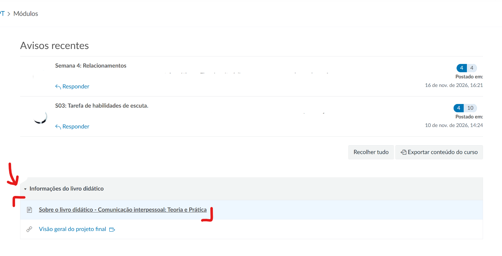
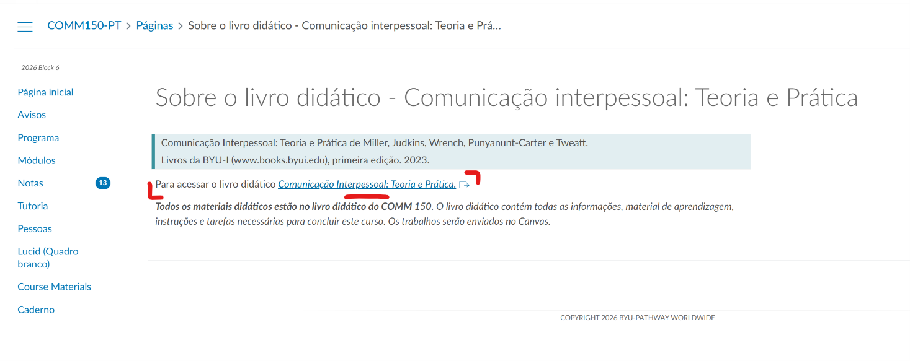
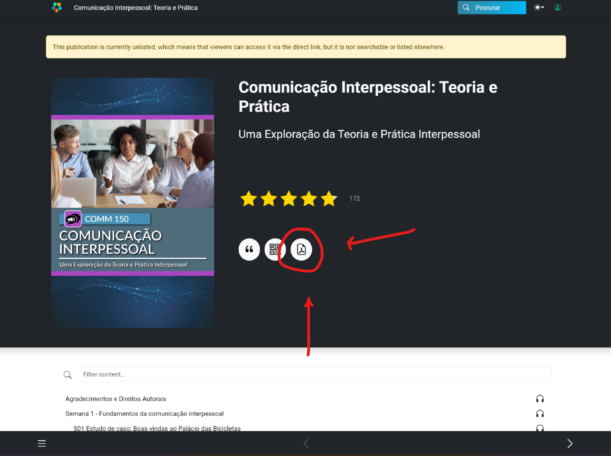
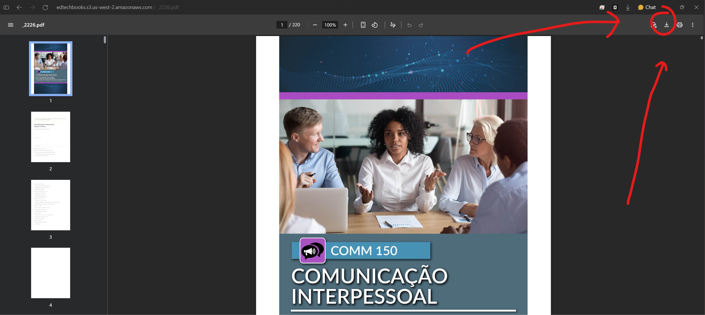

# 13 — Como baixar o PDF do livro

Guia rápido para baixar o PDF do livro didático pelo site do Pathway. Entre com
sua conta do Pathway e abra o curso. As imagens usam o **COM 150** como exemplo;
o caminho é o mesmo para outros cursos que usam o livro no site.

**Versão em PDF para enviar:** [`13-COMO-BAIXAR-O-PDF.pdf`](13-COMO-BAIXAR-O-PDF.pdf)

## Em 4 passos

1. Abra o curso e clique em **Informações do livro didático**.
2. Clique em **Sobre o livro didático**.
3. Clique no **ícone de PDF** ao lado da capa.
4. Clique no **ícone de download** para salvar.

## Passo 1 — Abra o curso e entre em “Informações do livro didático”

Na página inicial do curso, clique em **Informações do livro didático** e
depois em **Sobre o livro didático — Comunicação interpessoal: Teoria e
Prática**.



## Passo 2 — Abra o link do livro

Na página “Sobre o livro didático”, clique no link **Comunicação Interpessoal:
Teoria e Prática**.



## Passo 3 — Clique no ícone de PDF

Na página do livro, clique no **ícone de documento/PDF** (o terceiro ícone, ao
lado da capa). O aviso “currently unlisted” é normal.



## Passo 4 — Baixe o arquivo

O PDF abre no navegador. Clique no **ícone de download** no canto superior
direito e salve o arquivo no computador.



## Depois de baixar

O arquivo pode ser salvo com um nome como `_2226.pdf`. Renomeie para algo fácil,
como `COM 150.pdf`, e guarde em uma pasta que você encontre depois.

Abra o **Pathway PDF TTS**:

1. Escolha **Automático — Pathway primeiro**.
2. Arraste o PDF para a interface.
3. Confira os capítulos detectados.
4. Clique em **Gerar áudios**.

Se o PDF não tiver os títulos do Pathway, o app avisa e divide em blocos de
páginas.

## Se algo der errado

- O link não abriu? Permita pop-ups para o site do curso.
- O ícone de download não apareceu? Abra o PDF em uma nova aba.
- O arquivo baixou como `_2226.pdf`? Renomeie para `COM 150.pdf`.
- O Windows bloqueou o app? Use a versão principal, que usa o Python assinado
  pela PSF; detalhes em [`12-ONE-CLICK-APP.md`](12-ONE-CLICK-APP.md).

## Como regenerar este tutorial

As imagens ficam em `DOCS/assets/como-baixar-pdf/` e o PDF é gerado por:

```powershell
python scripts/build_download_tutorial.py
```

O script usa `reportlab` e `Pillow`, que já estão nas dependências de
desenvolvimento.

Uso pessoal. O PDF e o áudio pertencem aos autores originais; não redistribua.
